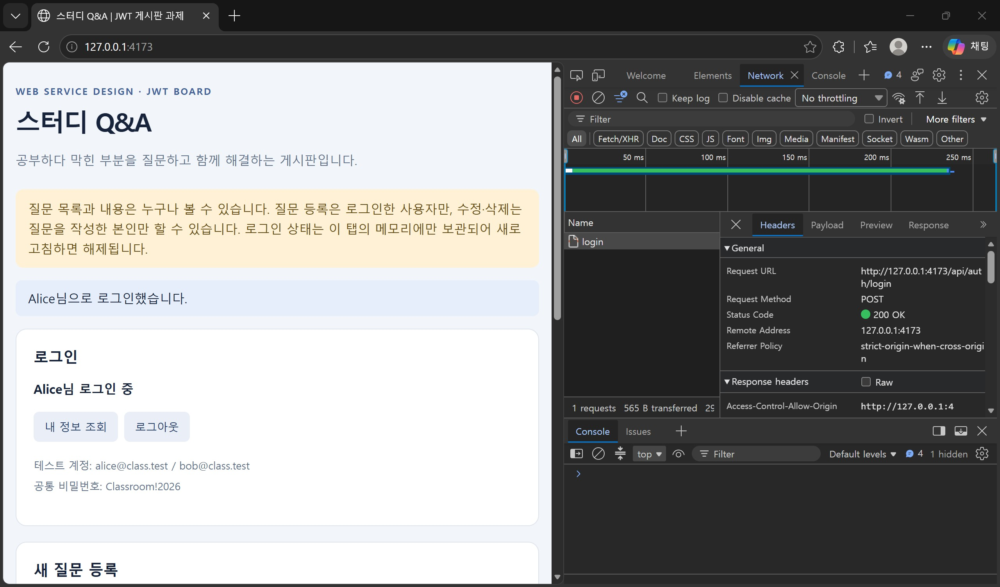
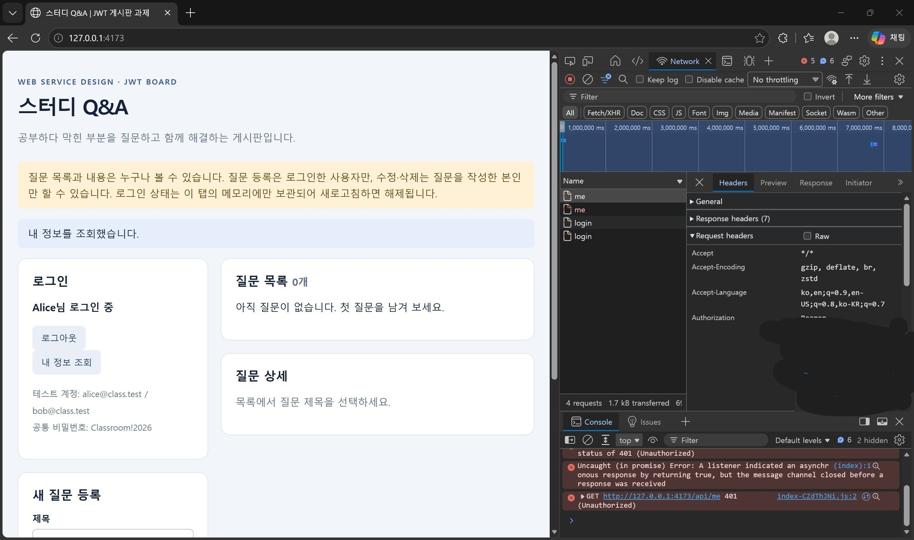
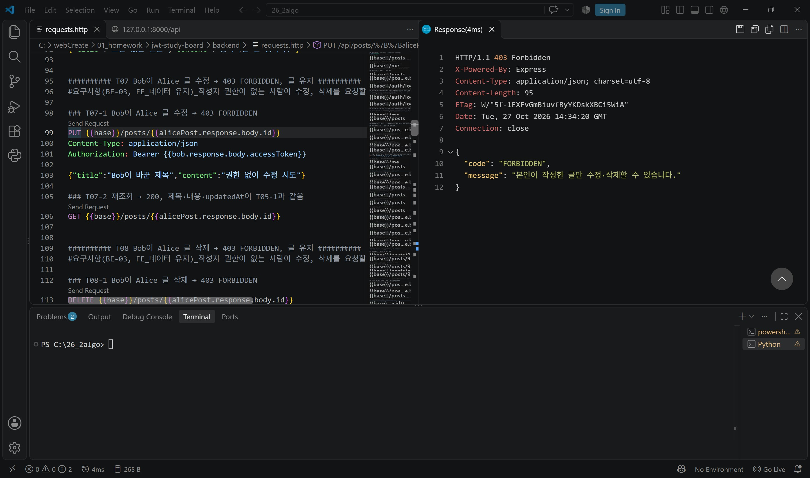
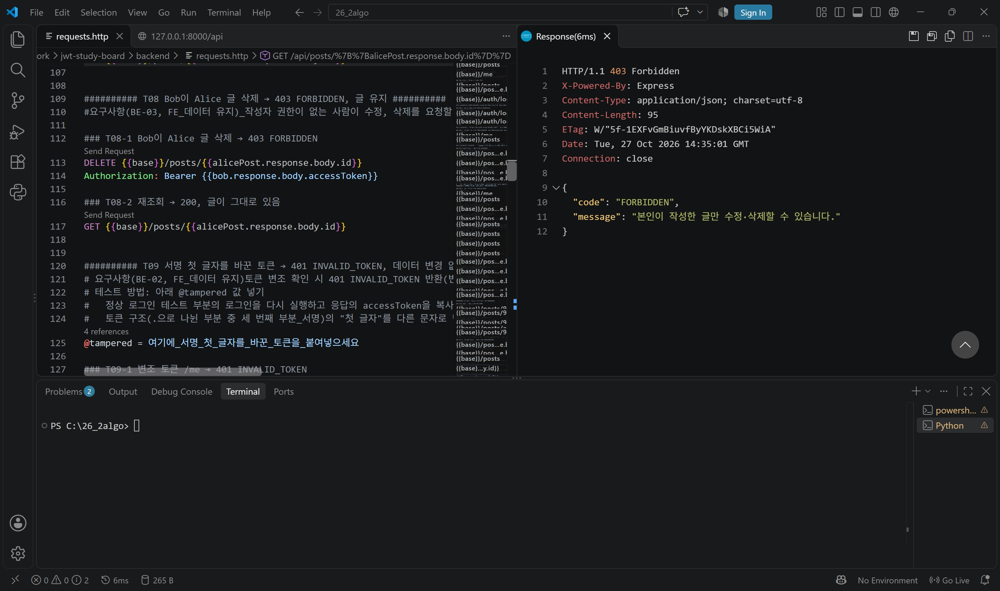
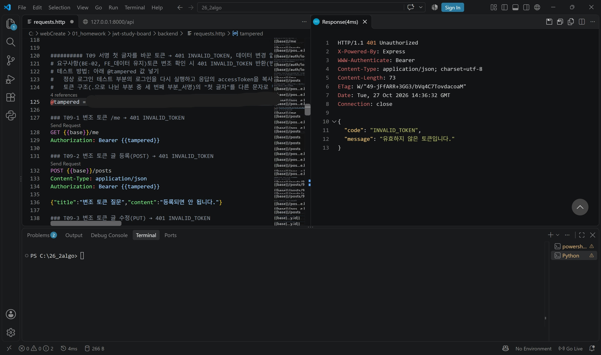
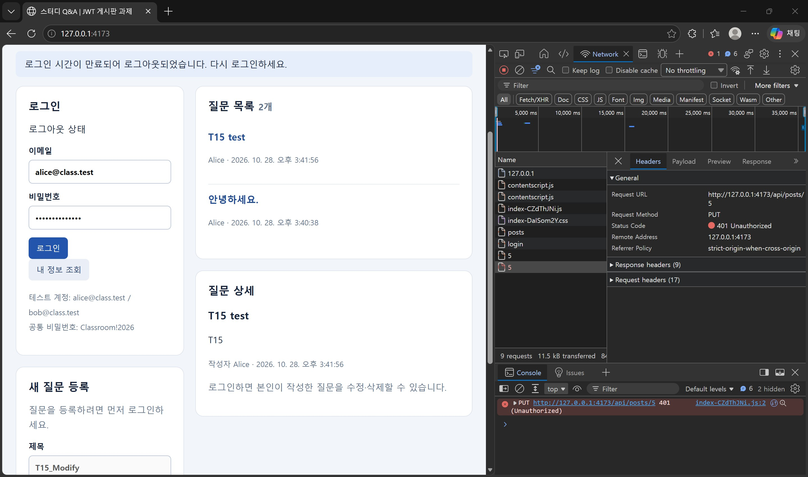
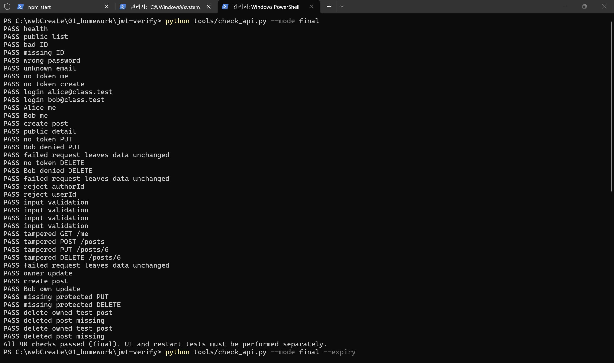
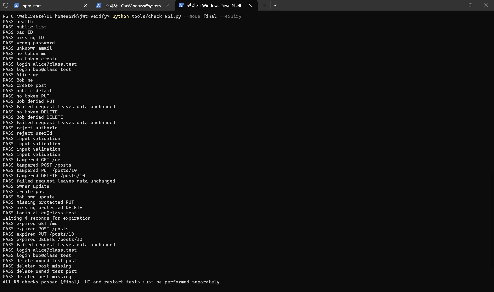

# JWT 게시판 구현 보고서 — 스터디 Q&A

## 1 서비스 소개와 구현 범위

학번: 202012174  이름: 김선재  제출일: 2026-10-28

서비스 이름: 스터디 Q&A 게시판

기술 조합과 버전: Vue 3.5.43 (Vite 8.3.4) / Express 5.3.0 (jsonwebtoken 9.0.3, sql.js 1.14.2) / Node.js 24.22.0, Windows 11

GitHub 저장소 URL: https://github.com/sjlys0205/26_02_homework_login

소스 코드 기준: `main` 브랜치 / 코드 구현 기준 커밋 `5e9ea42` (이후 커밋은 테스트 증거·문서). 최종 제출 기준 커밋 SHA는 LMS에 제출함.

**서비스 소개와 선택 이유**

스터디 Q&A는 같은 과목이나 전공을 공부하는 학생들이 막힌 개념이나 오류를 질문으로 남기고 서로 고민해가면서 성장하는 것을 지향하고자 구성한 서비스입니다. 지식의 성장은 아는 것을 공유하고 오류를 해결해 나가는 과정에서 이루어진다고 믿습니다. 질문 목록과 내용은 로그인하지 않아도 누구나 읽을 수 있어 비슷한 문제를 겪는 학생이 바로 참고할 수 있습니다. 질문 등록은 로그인한 사용자만, 수정·삭제는 질문을 쓴 본인만 할 수 있어 질문 작성자를 식별하고 타인이 질문을 임의로 수정할 수 없습니다. Vue + Express 조합은 수업 실습(week03-express-vue, jwt-basic)에서 사용한 구조와 같아 JWT 흐름을 이해하는 데 수월할 것 같다고 판단해 선택했습니다. 제공 템플릿에서는 인증 부분(`backend/src/auth.js` 전체, `frontend/src/api.js`의 FE-01~04)을 구현하고, 화면(`App.vue`)은 응답 코드별 안내·작성자별 버튼·로그아웃과 스터디 Q&A 문구로 바꿨습니다. 라우트·입력 검사(`app.js`), 저장소(`store.js`), 계정 검증(`users.js`)은 제공된 코드를 유지했습니다.

| 기능 | 완료 여부 | 관련 파일 | 비고 또는 제한 |
|---|---|---|---|
| 공개 목록과 상세 | 완료 | `app.js` GET `/api/posts`, `/api/posts/:id` / `api.js` `api.list`, `api.detail` | 제공 코드 유지, 토큰 없이 조회 확인(T01) |
| 로그인과 JWT 발급 | 완료 | `auth.js` `loadConfig`, `issueToken` / `api.js` `login` | HS256, sub·iss·aud·exp, 기본 TTL 90초 |
| 인증과 내 정보 조회 | 완료 | `auth.js` `readBearer`, `currentUserId`, `validClaims` / `app.js` GET `/api/me` | 실제 계정 존재까지 확인 |
| 본인 글 작성·수정·삭제 | 완료 | `app.js` POST·PUT·DELETE / `auth.js` `assertOwner` / `api.js` `canEdit` | 작성자 ID는 토큰에서만 결정 |
| 만료·로그아웃·오류 표시 | 완료 | `api.js` `request`, `clearSession` / `App.vue` `describe`, `run`, `logout` | 로그아웃은 탭의 토큰 삭제(서버 무효화 없음) |
| DB 데이터 유지 | 완료 | `store.js` (sql.js, `data/board.sqlite`) | 제공 코드 유지, 재시작 후 유지 확인(T15) |

## 2 구조와 변경 내역

**연결 구조**

```text
브라우저 (http://127.0.0.1:4173, Vue 빌드본)
  │  App.vue ── api.js  ← 토큰·user는 api.js의 session 변수(메모리)에만 저장
  │  fetch("/api/...")   (같은 출처로만 요청)
  ▼
Vite preview 프록시  /api → http://127.0.0.1:8000
  ▼
Express (app.js 라우트 → auth.js 인증·권한 → store.js)
  ▼
SQLite 파일 DB  backend/data/board.sqlite (sql.js, 변경 때마다 파일 저장)
```

**로그인 요청 흐름:** 로그인 폼 → `api.js` `login()` → `POST /api/auth/login` (Authorization 헤더 없음) → `app.js`가 `fields()`로 email·password 형식 검사 → `users.js` `verifyCredentials()`로 비밀번호 확인 → `auth.js` `issueToken()` → `200 {accessToken, expiresIn, user}` → `api.js`가 `session`에 저장 → 화면에 "(사용자이름)님 로그인 중" 표시.

**게시글 수정 요청 흐름:** 수정 저장 → `api.update()` → `request()`가 `authorizationHeaders()`로 `Authorization: Bearer <JWT>` 첨부 → `PUT /api/posts/:id` → `currentUserId()`(401) → `postId()`(400) → `getPost()`(404) → `assertOwner()`(403) → `fields()`(400) → `store.update()` → 200. 토큰은 **`/me`와 글 등록·수정·삭제 요청에만** 실리고, 공개 목록·상세 요청에는 로그인 상태일 때만 함께 붙습니다(서버는 확인하지 않음).

| 변경한 파일과 함수 | 제공 코드의 원래 역할 | 내가 변경한 내용 | 변경 이유 · 작성 출처 |
|---|---|---|---|
| `backend/src/auth.js` / `loadConfig` (추가) | 없음 | `.env`의 JWT_SECRET이 64자리 16진수인지, TOKEN_TTL이 1 이상 정수인지 검사하고 32바이트 키로 변환. 잘못되면 서버 시작 거부 | 예시 키·빈 키로 서버가 뜨지 않게(BE-01) · AI 초안 후 본인 확인, 수업 예제 `createAuth` 참고 |
| `backend/src/auth.js` / `issueToken` | 501 NOT_IMPLEMENTED 반환 | HS256으로 sub(문자열 ID)·iss·aud·exp(TTL) 토큰 발급 | BE-01 · AI 초안 작성 및 본인 확인, 수업 예제 참고 |
| `backend/src/auth.js` / `currentUserId`, `readBearer`, `validClaims` | 항상 데모 ID `1` 반환 | Bearer 추출 → `jwt.verify`(HS256 고정, iss·aud) → 클레임 형식 → 실제 계정 확인. 실패 시 401 TOKEN_REQUIRED/TOKEN_EXPIRED/INVALID_TOKEN | BE-02 · AI 초안 작성 후 본인 확인, 수업 예제 참고 |
| `backend/src/auth.js` / `assertOwner` | 아무 검사도 하지 않음 | 검증된 사용자 ID ≠ DB 작성자 ID이면 403 FORBIDDEN | BE-03 · AI 초안 작성 후 본인 확인 |
| `backend/src/app.js` / 시작 로그 | "인증 TODO 미완성" 출력 | "JWT 인증·작성자 권한 적용" 문구로 변경 | 본인이 실행 화면에서 발견 → AI가 수정 |
| `frontend/src/api.js` / `authorizationHeaders`, `request`, `login`, `canEdit` | 헤더 없음, 401 처리 없음, 로그인 미구현, `canEdit`는 항상 true | 토큰 있을 때만 Bearer 헤더, 204·비JSON 응답 안전 처리, 401이면 `clearSession`, 로그인 결과를 메모리에 저장, 작성자 비교 | FE-01~04 · AI 초안 작성 후 본인 확인, 수업 예제 `public/app.js` 참고 |
| `frontend/src/App.vue` / `describe`, `run`, `doLogin`, `save`, `logout`, 템플릿 | 데모 배너, 로그인 미연결, 모든 글에 수정 버튼 | 상태·code별 안내, 401 시 화면 로그인 해제, 404 시 목록 갱신, 400 시 입력 유지, 비로그인 작성 안내, 작성자에게만 수정·삭제 버튼, 로그아웃, 내 정보 조회 버튼 상시 표시(T11) | FE-03·04 · AI 초안 작성 후 본인 확인 |
| `frontend/index.html` | 시작 코드 제목 | "스터디 Q&A \| JWT 게시판 과제" | 서비스 이름 반영 |
| `backend/requests.http` (추가) | 없음 | T01~T17 수동 테스트 요청 모음 | 테스트 재현 목적 · AI가 구성, 각 항목별 테스트 및 요구사항의 실행 로직 파악 후 직접 주석 작성 |
| `backend/src/store.js`, `users.js`, `errors.js`, `app.js` 라우트 | 저장소·계정·오류·라우트 | 변경 없음 | 제공 코드 유지 |

## 3 핵심 코드 설명

### 3.1 로그인과 JWT 발급

파일 / 함수: `backend/src/app.js` POST `/api/auth/login` (45-60행), `backend/src/auth.js` `issueToken` (29-37행)

```js
// app.js
app.post("/api/auth/login", (req, res) => {
  const input = fields(req.body, { email: 254, password: 128 });
  const user = verifyCredentials(input.email, input.password);
  if (!user)
    throw new ApiError(401, "INVALID_CREDENTIALS", "이메일 또는 비밀번호를 확인하세요.");
  const accessToken = issueToken(user);
  res.json({ accessToken, expiresIn: Number(process.env.TOKEN_TTL || 90), user });
});
// auth.js
export function issueToken(user) {
  return jwt.sign({}, config.key, {
    algorithm: "HS256",
    subject: String(user.id), // sub: 문자열 사용자 ID
    issuer: config.issuer,    // iss
    audience: config.audience, // aud
    expiresIn: config.ttl,    // exp = 발급 시각 + ttl초
  });
}
```

- **입력:** JSON 본문 `{email, password}`.
- **처리:** `fields()`가 두 필드만 허용하고 문자열·길이를 검사합니다(아니면 **400 BAD_INPUT** 반환). `verifyCredentials()`가 scrypt 해시로 비밀번호를 비교하고, 틀린 비밀번호와 없는 이메일은 똑같이 **401 INVALID_CREDENTIALS**로 거부합니다(두 필드 중 오류가 발생한 원인이 무엇인지 알려 주지 않음). 통과한 사용자에게만 `issueToken()`로 토큰을 만듭니다. 키는 서버 시작 시 `loadConfig()`가 `.env`의 64자리 16진수를 32바이트 Buffer로 바꾼 값이고, 토큰에는 sub·iss·aud·exp·iat만 들어가며 비밀번호나 해시는 넣지 않습니다.
- **출력:** **200** `{accessToken, expiresIn, user:{id,name,email}}`. TTL은 `.env`의 `TOKEN_TTL`(기본 90초)이며 TTL은 테스트 때 환경변수로 짧게 바꿀 수 있습니다.

### 3.2 브라우저 토큰 저장과 전송

파일 / 함수: `frontend/src/api.js` `session`, `authorizationHeaders`, `request`, `login` (3-58행)

```js
let session = { accessToken: "", user: null };   // 메모리에만 보관
function authorizationHeaders() {
  return session.accessToken
    ? { Authorization: `Bearer ${session.accessToken}` }
    : {};                                          // 토큰 없으면 헤더 자체를 안 보냄
}
// request() 안
  if (!response.ok) {
    if (response.status === 401) clearSession();  // 401이면 로그인 해제
    ...
  }
export async function login(email, password) {
  clearSession();
  const data = await request("/auth/login", { method: "POST", body: JSON.stringify({ email, password }) });
  session = { accessToken: data.accessToken, user: data.user };
  return data.user;
}
```

- **로그인 응답 처리:** 성공하면 토큰과 user를 모듈 변수 `session`에 넣고, 실패하면 `request()`가 오류를 던지므로 `session`은 빈 상태로 남습니다.
- **저장 위치:** localStorage·sessionStorage를 쓰지 않고 api.js의 변수(메모리)에만 저장하기 때문에 다른 스크립트가 저장소에서 토큰을 꺼낼 수 없고, 새로고침하면 사라집니다(T16).
- **Authorization 헤더:** 모든 요청이 `request()`를 거치므로 로그인 상태에서는 `Bearer <JWT>`가 붙고, 로그아웃 상태에서는 헤더가 아예 없습니다(T11-3, T11-4 비교).
- **로그아웃과 401:** `logout()`(App.vue)과 401 응답 모두 `clearSession()`으로 토큰과 user를 지우고, `App.vue`의 `run()`이 `user.value = getSession().user`로 화면도 로그아웃 상태로 바꿉니다. 403 응답은 토큰이 유효한 것이므로 로그인을 유지합니다.

### 3.3 서버 JWT 검증

파일 / 함수: `backend/src/auth.js` `currentUserId` (60-92행)

```js
export function currentUserId(req) {
  const token = readBearer(req);                 // "Bearer <토큰>" 형식이 아니면 null
  if (!token) throw new ApiError(401, "TOKEN_REQUIRED", "로그인이 필요합니다.");
  let payload;
  try {
    payload = jwt.verify(token, config.key, {
      algorithms: ["HS256"], issuer: config.issuer, audience: config.audience,
    });
  } catch (error) {
    if (error.name === "TokenExpiredError")
      throw new ApiError(401, "TOKEN_EXPIRED", "로그인 시간이 만료되었습니다. 다시 로그인하세요.");
    throw new ApiError(401, "INVALID_TOKEN", "유효하지 않은 토큰입니다.");
  }
  if (!validClaims(payload)) throw new ApiError(401, "INVALID_TOKEN", "토큰 정보가 올바르지 않습니다.");
  const userId = Number(payload.sub);
  if (!findPublic(userId)) throw new ApiError(401, "INVALID_TOKEN", "사용자를 확인할 수 없습니다.");
  return userId;
}
```

- **입력:** 요청의 `Authorization` 헤더.
- **처리:** ① 헤더가 없거나 `Bearer <토큰>` 형식이 아니면 **401 TOKEN_REQUIRED**를 반환. ② `jwt.verify`가 서버 키로 서명을 다시 계산해 비교하고, `algorithms: ["HS256"]`로 다른 알고리즘(예: `alg: none`)을 거부하며, exp 만료와 iss·aud를 검사합니다. 서명이 맞지만 만료된 토큰은 `TokenExpiredError` → **401 TOKEN_EXPIRED**을 반환, 서명 불일치·발급자/대상 불일치 등은 **401 INVALID_TOKEN**를 반환. ③ `validClaims`로 sub가 양의 정수 문자열이고 exp가 정수인지 확인합니다. ④ sub의 사용자가 실제로 있는지 `findPublic`으로 확인합니다.
- **출력:** 검증된 사용자 ID(숫자). `/me`와 글 등록·수정·삭제에서 사용자 확인은 이 값만 사용합니다.(별도로 입력받지 않음) 모든 401에는 `app.js` 오류 처리기가 `WWW-Authenticate: Bearer` 헤더를 붙입니다.

### 3.4 작성자 권한 검사

파일 / 함수: `backend/src/app.js` PUT·DELETE `/api/posts/:id` (77-91행), `backend/src/auth.js` `assertOwner` (95-103행)

```js
app.put("/api/posts/:id", (req, res) => {
  const userId = currentUserId(req),   // 401: 누구인지
    id = postId(req),                  // 400: ID 형식
    p = getPost(id);                   // 404: 글 존재
  assertOwner(userId, p.authorId);     // 403: 본인 글인지
  res.json(store.update(id, fields(req.body, { title: 100, content: 5000 }))); // 400: 입력
});
export function assertOwner(userId, authorId) {
  if (userId !== authorId)
    throw new ApiError(403, "FORBIDDEN", "본인이 작성한 글만 수정·삭제할 수 있습니다.");
}
```

- **비교 대상:** 토큰에서 검증한 현재 사용자 ID(`userId`)와 **DB에 저장된** 글의 작성자 ID(`p.authorId`). 요청 본문의 값은 비교에 사용하지 않습니다.
- **401과 403:** 401은 "누구인지 확인할 수 없음"(토큰 없음·변조·만료)이고, 403은 "누구인지는 확인됐지만 권한이 없음"(ex. Bob이 Alice 글의 수정 · 삭제 요청)입니다. 그래서 401이면 프론트가 로그인 상태를 해제하고, 403이면 로그인을 유지한 채 권한 없음을 안내 합니다(로그인 유지).
- **작성자 위조 방지:** 글 등록은 `store.create(fields(...), userId)`로 작성자를 토큰의 ID로만 정합니다. `fields()`는 title·content 외의 키(`authorId`, `userId` 등)가 있으면 **400 BAD_INPUT**으로 거부합니다(별도 입력을 거부하여, 타 이용자 ID 도용 방지 T12). 검사 순서상 `assertOwner`가 입력 검사보다 먼저기 때문에, Bob이 잘못된 입력(제목 빈칸, 글자수 초과 등)을 보내도 400이 아니라 403이 반환됩니다(T13 참고 요청).

## 4 테스트 결과와 증거

실행 환경: Windows 11 Home / Node.js 24.22.0, npm 11.19.1, Python 3.14.3 / Microsoft Edge (Chromium 156) / 백엔드 `npm start`(backend 폴더), 프론트 `npm run build` → `npm run preview`(4173), API 요청 VS Code REST Client(`backend/requests.http`)

로컬 배포 확인: GitHub 저장소를 새 폴더(`jwt-verify`)에 `git clone` → `backend`에서 `npm ci`(0 vulnerabilities), 새 `.env` 키 생성, `npm start` → `frontend`에서 `npm ci`, `npm run build`(✓ built), `npm run preview` → http://127.0.0.1:4173 접속, Network에서 `POST http://127.0.0.1:4173/api/auth/login` **200 OK** 확인 (E01~E04)

테스트 일시 및 코드 버전: 2026-10-18 로컬 배포(E01~E04, `11fd675`) / 2026-10-27 REST Client 테스트(T01~T09, T12~T14, T17, T06, `11fd675`) / 2026-10-28 브라우저 테스트(T03 재캡처, T10, T11, T15, T16)와 검사 스크립트(`5e9ea42`). 두 버전의 백엔드 코드는 같습니다.

토큰 TTL: 만료 테스트 10초(T10 수동 확인), expiry 자동 검사 3초(`check_api.py --expiry`) / 그 외 테스트 90초 

| ID | 수행 절차와 사용자 | 예상 결과 | 실제 HTTP와 code | 판정 | 증거 |
|---|---|---|---|---|---|
| T01 | 비로그인, 목록·상세 GET | 200 | 목록 200 / 해당 없음, 상세 200 / 해당 없음 | PASS | T01, T07-2, T08-2 |
| T02 | Alice 로그인 | 200, 토큰, 화면 표시 | 200 / 해당 없음, `expiresIn`·`user` 반환, "Alice님 로그인 중" | PASS | E04, T10-5, T16-1 |
| T03 | 틀린 비밀번호, 없는 이메일 | 401 INVALID_CREDENTIALS | 401 / INVALID_CREDENTIALS (두 경우 같은 메시지) | PASS | T03-1, T03-2 |
| T04 | 토큰 없이 /me, 글 등록 | 401 TOKEN_REQUIRED | 401 / TOKEN_REQUIRED, `WWW-Authenticate: Bearer` | PASS | T04-1, T04-2 |
| T05 | Alice 글 등록 후 /me | 201, authorId 1, Alice | 201 / 해당 없음, `Location: /api/posts/1`, authorId 1 → /me 200 Alice | PASS | T05-1, T05-2 |
| T06 | Alice 본인 글 수정·삭제 | 200, 204, 삭제 후 404 | 200(createdAt 유지, updatedAt 변경) → 재조회 반영 → 204 빈 본문 → 404 / NOT_FOUND | PASS | T06-1~4 |
| T07 | Bob이 Alice 글 수정 후 재조회 | 403, 글 유지 | 403 / FORBIDDEN → 200, 제목·내용·updatedAt 그대로 | PASS | T07-1, T07-2 |
| T08 | Bob이 Alice 글 삭제 후 재조회 | 403, 글 유지 | 403 / FORBIDDEN → 200, 글 존재 | PASS | T08-1, T08-2 |
| T09 | 서명 첫 글자 바꾼 토큰으로 /me·POST·PUT·DELETE | 401 INVALID_TOKEN, 변경 없음 | 4건 모두 401 / INVALID_TOKEN → 목록 그대로 | PASS | T09-1~5 |
| T10 | TTL 10초, Alice 로그인 후 11초 이상 대기, PUT·/me·POST·DELETE | 401 TOKEN_EXPIRED, 화면 해제 | 4건 모두 401, 화면 "로그인 시간이 만료되어 로그아웃되었습니다"·로그아웃 상태, 글 변경 없음 (검사 스크립트 expired 4건 PASS) | PASS | T10-1~5, T10-7~9, C02 |
| T11 | Alice 로그인 → 로그아웃 → 내 정보 조회 | 헤더 없음, 401 TOKEN_REQUIRED | 401 / TOKEN_REQUIRED("로그인이 필요합니다"), Request Headers에 Authorization 없음 (로그인 중에는 있음) | PASS | T11-1~4 |
| T12 | Bob 등록에 authorId:1 / userId:1 추가 | 400, 위조 글 없음 | 400 / BAD_INPUT 2건, 목록에 "위조 시도" 없음 | PASS | T12-1~3 |
| T13 | Alice 빈 제목·공백 본문·101자 제목 | 400, 변경 없음 | 400 / BAD_INPUT 3건 → 재조회 그대로 (참고: Bob 공백 제목 403 / FORBIDDEN) | PASS | T13-1~5 |
| T14 | 없는 글 조회·수정·삭제, 잘못된 ID | 404 / 400 | 404 / NOT_FOUND 3건, `/posts/abc` 400 / BAD_INPUT (참고: 무토큰 없는 글 수정 401) | PASS | T14-1~5 |
| T15 | 글 작성 → 백엔드 Ctrl+C → `npm start` | 글·작성자·내용 유지 | 종료 중 화면 HTTP 502 → 재시작 후 "T15 test"(Alice, 내용 T15) 등 2건 유지 | PASS | T15-1~4, T10-1 |
| T16 | Alice 로그인 후 F5 | 글 유지, 로그인 해제 | "로그아웃 상태", 목록 그대로 | PASS | T16-1, T16-2 |
| T17 | 무토큰 수정·삭제, Bob 본인 작성·수정·삭제 | 401 / 성공 | 401 / TOKEN_REQUIRED 2건 → 201(authorId 2) → 200 → 204 | PASS | T17-1~5 |

(증거 파일은 `docs/evidence/` 폴더의 같은 이름 `.jpg`입니다. T10의 code는 화면 안내가 `TOKEN_EXPIRED`일 때만 표시되는 문구이고, 검사 스크립트의 expired 검사로도 확인했습니다.)

### HTTP 응답 확인 기록

| 확인 항목 | 기대 응답 | 실제 HTTP와 code | 증거 위치 |
|---|---|---|---|
| 정상 조회·로그인·수정 | 200 | 200 / 해당 없음 | T01, T05-2, T06-1, T17-4 |
| 새 글 등록 | 201 및 Location | 201, `Location: /api/posts/1`, `/api/posts/2` | T05-1, T17-3 |
| 본인 글 삭제 | 204 및 빈 본문 | 204 No Content, 본문 없음 | T06-3, T17-5 |
| 입력 오류·추가 작성자 필드 | 400 BAD_INPUT | 400 / BAD_INPUT | T12-1·2, T13-1~3, T14-4 |
| 잘못된 계정 | 401 INVALID_CREDENTIALS | 401 / INVALID_CREDENTIALS | T03-1, T03-2 |
| 토큰 없음·헤더 형식 오류 | 401 TOKEN_REQUIRED | 401 / TOKEN_REQUIRED | T04-1·2, T11-1, T17-1·2 |
| 변조·클레임 오류 | 401 INVALID_TOKEN | 401 / INVALID_TOKEN | T09-1~4 |
| 정상 서명의 만료 토큰 | 401 TOKEN_EXPIRED | 401 / TOKEN_EXPIRED | T10-1·4·7·8, C02 |
| 다른 작성자의 변경 | 403 FORBIDDEN | 403 / FORBIDDEN | T07-1, T08-1, T13-5 |
| 없는 글 | 404 NOT_FOUND | 404 / NOT_FOUND | T06-4, T14-1~3 |

**WWW-Authenticate:** 보호 API의 401 응답(T03·T04·T09·T14-5·T17의 REST Client 응답, T10-2의 브라우저 Response headers)에 모두 `WWW-Authenticate: Bearer`가 있었습니다.

**401과 403의 화면 차이:** 401(만료, T10)에서는 화면이 "로그아웃 상태"로 바뀌고 "로그인 시간이 만료되어 로그아웃되었습니다. 다시 로그인하세요."가 표시됩니다. 403이면 `api.js`가 세션을 지우지 않으므로 로그인이 유지되고, `App.vue` `describe()`가 "본인이 작성한 질문만 수정·삭제할 수 있습니다. (로그인은 유지됩니다)"를 표시하도록 구현했습니다(코드 기준). 실제 화면에서는 다른 사용자의 질문에 수정·삭제 버튼 자체가 보이지 않아 403 응답은 REST Client로 확인했습니다(T07-1, T08-1).

**실패 후 데이터 불변:** T07-2·T08-2·T09-5·T12-3·T13-4·T10-9에서 실패한 요청 뒤 공개 조회 결과(제목·내용·updatedAt, 목록 개수)가 바뀌지 않았습니다. 검사 스크립트의 "failed request leaves data unchanged"도 모두 PASS입니다.

**토큰 없이 없는 글 수정 / 정상 토큰으로 없는 글 수정:** 토큰 없이 `PUT /api/posts/999999`는 **401 TOKEN_REQUIRED**(T14-5), Alice 토큰으로는 **404 NOT_FOUND**(T14-2)였습니다. 인증을 글 존재 확인보다 먼저 하기 때문입니다.

**증거 1 — 로그인 성공과 토큰이 첨부된 요청**

 

**증거 2 — Bob이 Alice 글 수정·삭제를 시도한 서버 응답**

 

**증거 3 — 토큰 변조·만료 시 서버 응답과 화면 처리**

 

**자동 검사:** 백엔드를 실행한 상태로 저장소 루트에서 `python tools/check_api.py --mode final`을 실행해 **All 40 checks passed**, 백엔드를 `$env:TOKEN_TTL="3"`으로 재시작한 뒤 `--mode final --expiry`로 **All 48 checks passed**를 확인했습니다. 제공 검사 도구가 로그인, 토큰 없음·변조·만료, 403, 입력 검사, 실패 후 데이터 유지를 실제 HTTP 요청으로 검사한다는 의미이며, 화면(UI)과 서버 재시작 테스트는 도구로 검사가 어려워 T10·T11·T15·T16으로 따로 확인했습니다.

 

## 5 AI 활용과 참고 자료

AI 사용 여부: 사용

구현 단계 계획, 인증 코드 초안, 테스트 요청 구성, README·보고서 초안 구성에 AI를 사용했습니다. 코드는 단계마다 변경한 코드를 확인하고 변경 이유와 동작 설명을 듣고 직접 요청을 보내 결과를 확인하였으며, T01~T17과 검사 스크립트는 모두 직접 실행하여 테스트 했습니다.

| 도구와 모델 | 사용 목적 | 반영한 파일 또는 보고서 항목 | 반영 방식 |
|---|---|---|---|
| Claude Code (Anthropic, Claude Opus 5.5) | 설계·생성 | `backend/src/auth.js` (BE-01~03) | 수정 후 반영 (코드 및 설명 확인) |
| Claude Code (Claude Opus 5.5) | 생성·디버깅 | `frontend/src/api.js`, `App.vue` (FE-01~04, T11 버튼) | 수정 후 반영 |
| Claude Code (Claude Opus 5.5) | 테스트 | `backend/requests.http`, 테스트 캡처 이미지 검토 | 요청은 반영, 요구사항을 docs에서 확인 및 검증 후 주석 직접 작성 |
| Claude Code (Claude Opus 5.5) | 결과정리 | `README.md`, report.pdf | 초안에 대해 본인이 검토·수정 |

### 대표 사례

**사례 1 — 서버 JWT 검증(BE-02)**

도구 / 날짜: Claude Code (Claude Opus 5.5) / 2026-10-18

요청한 내용: 과제 명세의 BE-02(토큰 없음·변조·만료 구분, 허용 알고리즘 고정, 실제 계정 확인)를 수업 예제 `jwt-basic/auth.mjs` 구조를 참고해 구현하고, 각 단계의 동작을 설명해 달라고 요청.

AI가 제안한 내용: `readBearer`로 Bearer 추출 → `jwt.verify`에 `algorithms: ["HS256"]`·issuer·audience 지정 → `TokenExpiredError`만 TOKEN_EXPIRED, 나머지는 INVALID_TOKEN → `validClaims` → `findPublic`으로 계정 확인.

실제 반영 위치: `backend/src/auth.js` `currentUserId`, `readBearer`, `validClaims` (커밋 `a0c3a1e`)

내가 확인하고 수정한 내용: decode만 하면 서명을 확인하지 않는다는 것을 확인함, 만료와 변조가 어디에서 분기되는 지를 확인함.

검증 방법과 결과: 구현 직후 AI가 토큰 없음·형식 오류·변조·만료·다른 키·없는 사용자 등 16가지 경우를 검사 스크립트로 실행해 결과(모두 기대값인 401 code)를 보여 줌. 이후 본인이 직접 T04·T09·T10과 `check_api.py`(40/40, 48/48)를 실행해 PASS 확인.

**사례 2 — 로그아웃 후 /me 테스트가 불가능한 문제(T11)**

도구 / 날짜: Claude Code (Claude Opus 5.5) / 2026-10-28

요청한 내용: T11(로그아웃 후 다음 /me 요청에 토큰이 빠지고 401) 수행 방법을 물음.

AI가 제안한 내용: 기존 화면은 "내 정보 조회" 버튼이 로그인 중에만 보여 로그아웃 후 /me 요청을 보낼 방법이 없으므로, 버튼을 항상 표시하자고 제안. `api.js`는 토큰이 없으면 헤더를 만들지 않으므로 다른 코드는 바꿀 필요가 없다고 설명.

실제 반영 위치: `frontend/src/App.vue` 로그인 카드 템플릿 (커밋 `5e9ea42`)

내가 확인하고 수정한 내용: 변경 범위가 버튼 뿐인지 확인하고 Network의 Request Headers에서 결과를 직접 확인.

검증 방법과 결과: 재빌드 후 로그아웃 → 내 정보 조회 → `GET /api/me` 401, Request Headers에 Authorization 없음(T11-3), 로그인 중에는 `Authorization: Bearer` 있음(T11-4).

### 참고 자료

| 자료 제목과 URL | 사용한 위치 | 반영 내용 및 출처 표시 |
|---|---|---|
| 수업 예제 `jwt-basic/auth.mjs` (`createAuth`, `issueToken`, `readBearer`, `validClaims`) | `backend/src/auth.js` | 설정 검사·발급·Bearer 읽기·클레임 검사 구조 참고, 코드 주석에 출처 표시 |
| 수업 예제 `jwt-basic/public/app.js` (메모리 토큰, Authorization 헤더) | `frontend/src/api.js` | `authorizationHeaders`, `login` 구조 참고, 코드 주석에 출처 표시 |
| 수업 예제 `week03-express-vue` | 프로젝트 구조 이해 | Express + Vue 프록시 구조 참고 |
| 과제 제공 시작 코드(frontend-vue, backend-express)와 `tools/check_api.py` | 저장소 전체 | 라우트·저장소·계정·화면 골격 유지, 검사 도구 그대로 사용 |
| jsonwebtoken 문서 https://github.com/auth0/node-jsonwebtoken | `auth.js` `jwt.sign`, `jwt.verify` | 옵션(algorithm, subject, issuer, audience, expiresIn)과 `TokenExpiredError` |
| RFC 7519 JSON Web Token https://www.rfc-editor.org/rfc/rfc7519 | `issueToken`, `validClaims` | sub를 문자열로 넣는 이유, 등록 클레임 의미 |
| RFC 6750 Bearer Token Usage https://www.rfc-editor.org/rfc/rfc6750 | `readBearer`, 401 응답 | `Authorization: Bearer`, `WWW-Authenticate: Bearer` |

## 6 이해도 확인과 회고

1. 요청 본문의 authorId를 믿으면 어떤 문제가 생기며, 내 코드는 어떻게 막는가?

요청 본문의 authorId가 진정한 사용자라고 믿으면 유효한 토큰을 가진 사용자가 다른 사용자를 도용할 수 있습니다.

가령, Bob(ID: 2)이라는 사용자가 본인의 유효한 계정정보로 accessToken을 받은 뒤, 글을 작성할 때, 본문에 Alice(ID: 1)의 ID를 authorId로 입력하고 본문을 작성하면 Bob이 쓴 글이 Alice가 쓴 글로 보여질 수 있습니다. 수정이나 삭제시에는 Bob이 Alice 사용자의 ID를 본문의 authorId를 넣으면 Alice 사용자가 쓴 글을 무단으로 지울 수 있습니다.

그렇기 때문에 요청을 받은 서버는 요청을 보낸 사람이 진짜 사용자인지를 항상 검증해야 하며, 요청자가 단순히 제공한 정보를 믿으면 안됩니다.

이를 막기 위해 코드로 삽입, 수정, 삭제 요청이 들어오면 사용자의 정보는 authorId로 받지 않고 currentUserId()로 서버가 직접 확인하도록 구현하였습니다. 또한 fields()가 title·content 외의 필드(authorId, userId 등)를 400 BAD_INPUT으로 거부합니다(T12-1·2,T12-3에서 위조 글 없음 확인).

ex)app.js POST에서 store.create(fields(...), userId)을 통해 글을 생성할 때 앞에서 currentUserId()로 생성한 userId를 사용

2. 수정 버튼을 숨기는 것만으로 충분하지 않은 이유는 무엇이며, 서버의 어떤 함수가 권한을 검사하는가?

수정 버튼은 단순히 화면이자 사용자가 서버에 요청을 편하게 하기 위한 기능일 뿐, 버튼이 없어도 웹에 대한 어느 정도의 지식을 가진 사람은 개발자 도구나 REST Client 등으로 PUT/DELETE 요청을 직접 보낼 수 있습니다.(실제로 T07·T08을 REST Client로 보내 403 확인) 그러기 때문에 클라이언트의 요청이 모두 올바른 요청이라고 믿지 않고, 서버에서 다시 한 번 권한을 검사해야 합니다.

백엔드 함수 중 auth.js assertOwner(userId, p.authorId) 함수가 토큰으로 검증한 ID와 DB에 기록된 작성자를 비교하여 두 ID가 다를 경우 403 코드를 반환하여 권한이 없음을 알립니다.


3. JWT decode와 verify의 차이는 무엇이며, 내 코드는 어떤 검증을 수행하는가?

JWT decode는 말 그대로 decode의 역할만 수행합니다.(즉, Base64URL로 된 header와 payload를 JSON 형태로 반환함)

이는 토큰의 유효성, 위/변조 여부 등을 전혀 확인하지 않기 때문에, 보안을 위해서는 반드시 verify로 검증을 거쳐야 합니다.

제 코드에서는 algorithms ["HS256"]로 토큰 알고리즘을 고정하고, 서명 검증, 토큰 유효시간(exp) 검증, validClaims(토큰 내 정보 유효성 검증), findPublic(유효 사용자 검증) 등을 수행합니다.(T09 변조 -> INVALID_TOKEN, T10 만료 -> TOKEN_EXPIRED 등 참조)


4. 로그아웃, 토큰 만료, 새로고침은 각각 무엇을 바꾸는가? 이미 복사된 토큰은 어떻게 되는가?

- 로그아웃: clearSession()으로 탭 메모리에 남아있는 토큰 및 user를 삭제합니다.(T11 참조)
- 토큰 만료: 서버가 exp 지난 토큰에 대해 401 TOKEN_EXPIRED를 반환하고, 프론트는 그 응답을 받으면 clearSession()실행 후 재 로그인을 안내합니다.(T10 참조)
- 새로고침: JS 메모리가 초기화되어 토큰 정보가 사라져 로그인 상태가 해제되지만, 글은 DB에 저장되어 있어 유지됩니다.(T16 참조)
- 이미 복사된 토큰은 로그아웃을 해도 exp가 경과하기 전까지 유효합니다.(서버는 무상태성을 가지므로 토큰 보관 안함)
- 이 방식에 따른 취약점을 보완하고자 TTL을 짧게 설정한 것입니다.

5. 가장 어려웠던 오류 한 가지와 원인 확인·수정·재검증 과정을 설명하라.

구현 후 자동 검사를 실행할 때, check_api.py --mode final 검사는 통과했으나 --expiry 검사에서 Set TOKEN_TTL=3 before --expiry 에러와 함께 중단되는 문제가 발생했습니다. 원인을 분석해 보니, 서버가 구현 당시의 기본 설정(90초)으로 토큰을 발급하고 있어 만료 검사 스크립트가 토큰 만료까지 수십 초 동안 기다려야 하는 문제가 있었습니다. 이를 해결하기 위해 기존 백엔드 종료 후 $env:TOKEN_TTL="3"; npm start 명령어로 TTL을 3초로 단축하여 백엔드를 구동 후 --expiry를 실행하였고, 그 결과 모든 만료 테스트(GET, POST, PUT, DELETE)를 포함한 48개 항목이 모두 통과하는 것을 확인했습니다. 검사 완료 후에는 Remove-Item Env:TOKEN_TTL 명령어로 환경 변수를 제거하여 TTL을 90초로 되돌리고, 로그인 응답에서 expiresIn=90이 정상 복원되었음을 다시 확인했습니다. 이와 관련하여 토큰의 만료 시간은 발급 시점에 고정되며 서버 시작 시 loadConfig()를 통해 TOKEN_TTL이 반영되는 JWT의 특징에 대해 더 알아볼 수 있었습니다.

현재 남은 문제와 다음에 개선할 점: 로그아웃해도 이미 발급된 토큰은 만료까지 유효하기 때문에 보안을 위해 TTL을 짧게 두었지만 실제 사용 환경에서 이렇게 운영되면 정상적인 서비스가 불가능할 것이므로 토큰 차단 목록 등의 방법으로 토큰의 유효성을 관리하는 것이 필요합니다. 또한 현재는 게시판만 만들었지만 원 서비스의 목적인 Q&A가 원활하려면 작성된 글에 대한 답변(댓글) 기능이 필요한데 지금은 구현하지 못했으므로 추후 해당 내용에 대해 공부하여 기능을 추가하고자 합니다.

제출 확인: [x] 실제 코드와 설명 일치 [x] 테스트 직접 수행 [x] AI 활용 및 출처 기록 [x] 비밀 키와 토큰 제거

GitHub 확인: [x] 루트 README 작성 [ ] 보고서 PDF와 증거 업로드 [ ] README 문서 링크 확인 [x] 교수자 접근 가능 [ ] 저장소 URL과 커밋 SHA 제출
